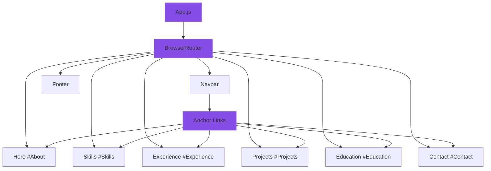
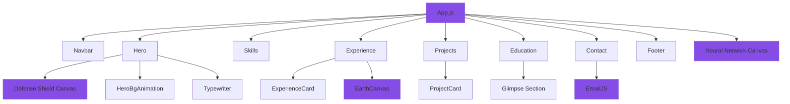
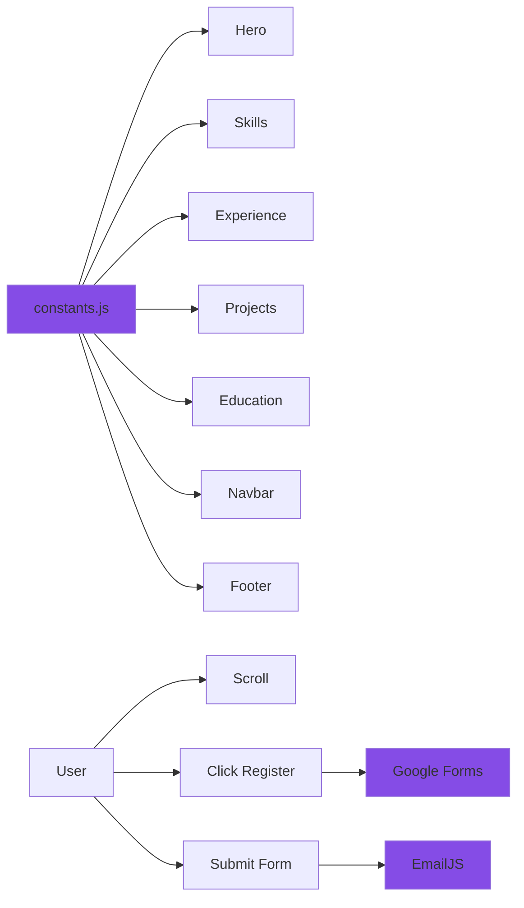
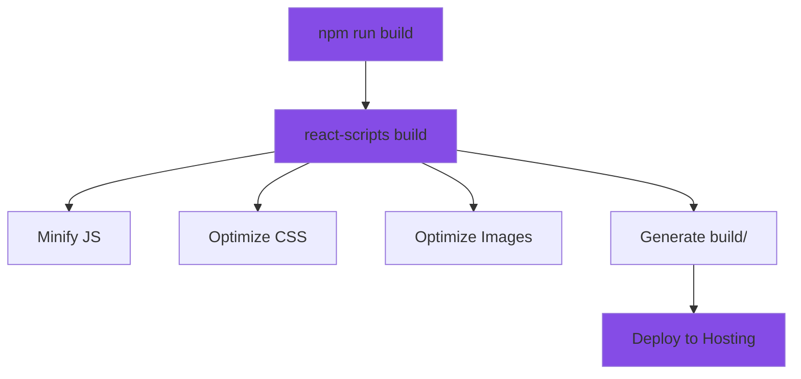

# HackKshetra 2.0 - Architecture Documentation

## High-Level System Architecture

```
┌─────────────────────────────────────────────────────────────┐
│                         Browser                              │
│  ┌─────────────────────────────────────────────────────────┐ │
│  │              React Application (SPA)                    │ │
│  │  ┌──────────────┐  ┌──────────────┐  ┌──────────────┐ │ │
│  │  │   Components │  │     Data     │  │    Utils     │ │ │
│  │  │              │  │  (constants) │  │              │ │ │
│  │  │ - Navbar     │  │              │  │ - Themes     │ │ │
│  │  │ - Hero       │  │ - Bio        │  │ - Motion     │ │ │
│  │  │ - Skills     │  │ - skills     │  │              │ │ │
│  │  │ - Experience │  │ - experiences│  │              │ │ │
│  │  │ - Projects   │  │ - education  │  │              │ │ │
│  │  │ - Education  │  │ - projects   │  │              │ │ │
│  │  │ - Contact    │  │              │  │              │ │ │
│  │  │ - Footer     │  │              │  │              │ │ │
│  │  └──────────────┘  └──────────────┘  └──────────────┘ │ │
│  │         │                    │                  │       │ │
│  │         └────────────────────┼──────────────────┘       │ │
│  │                              │                          │ │
│  │                    ┌─────────▼─────────┐                │ │
│  │                    │  Styled Components│                │ │
│  │                    │  (CSS-in-JS)      │                │ │
│  │                    └───────────────────┘                │ │
│  └─────────────────────────────────────────────────────────┘ │
│                                                              │
│  ┌─────────────────────────────────────────────────────────┐ │
│  │              External Services (API Calls)                │ │
│  │  ┌──────────────┐  ┌──────────────┐  ┌──────────────┐   │ │
│  │  │   EmailJS    │  │ Google Forms │  │   VVCE       │   │ │
│  │  │ (Contact)    │  │ (Registration)│  │ (Images)     │   │ │
│  │  └──────────────┘  └──────────────┘  └──────────────┘   │ │
│  └─────────────────────────────────────────────────────────┘ │
│                                                              │
│  ┌─────────────────────────────────────────────────────────┐ │
│  │                   Static Assets                          │ │
│  │  ┌──────────────┐  ┌──────────────┐  ┌──────────────┐   │ │
│  │  │   Images     │  │  3D Models   │  │   Files      │   │ │
│  │  │ (src/images) │  │ (public/planet)│  │ (public/*.pptx)│ │ │
│  │  └──────────────┘  └──────────────┘  └──────────────┘   │ │
│  └─────────────────────────────────────────────────────────┘ │
└─────────────────────────────────────────────────────────────┘
```

## Architecture Type

**Client-Side Single-Page Application (SPA)**
- No backend server
- No database
- No server-side rendering
- Static hosting only
- All logic runs in browser

## Component Hierarchy

```
App.js (Root)
├── ThemeProvider (darkTheme)
├── BrowserRouter
├── Navbar
├── Body
│   ├── NetworkEnvironment (3D neural network)
│   ├── Wrapper
│   │   ├── Hero
│   │   │   ├── DefenseShield
│   │   │   ├── HeroBgAnimation
│   │   │   └── Content (Title, Typewriter, Button, Image)
│   │   ├── Skills
│   │   │   └── Skill Cards (with Modal)
│   │   └── Experience
│   │       ├── VerticalTimeline
│   │       │   └── ExperienceCard (x5)
│   │       └── EarthCanvas
│   ├── Projects
│   │   ├── Toggle Buttons
│   │   └── ProjectCard (filtered)
│   ├── Wrapper
│   │   ├── Education
│   │   │   ├── Prize Cards (x2)
│   │   │   └── Glimpse Section (toggle)
│   │   └── Contact
│   │       └── Contact Form
│   └── Footer
└── /Body
```

## Data Flow Architecture

```
┌─────────────────────────────────────────────────────────────┐
│                    Data Flow Diagram                        │
└─────────────────────────────────────────────────────────────┘

User Action
    │
    ├─→ Scroll to section
    │       └─→ Browser smooth scroll to anchor
    │
    ├─→ Click "Register Now"
    │       └─→ Navigate to Google Forms URL
    │               └─→ External service handles registration
    │
    ├─→ Click track card
    │       └─→ Set state: setOpenModal({state: true, track: data})
    │               └─→ Modal renders with track description
    │
    ├─→ Click toggle button (Contributors)
    │       └─→ Set state: setToggle(category)
    │               └─→ Filter projects array
    │                       └─→ Render filtered ProjectCards
    │
    ├─→ Click "Glimpses" button
    │       └─→ Set state: setShowGlimpse(!showGlimpse)
    │               └─→ Toggle glimpse section visibility
    │
    ├─→ Submit contact form
    │       └─→ Prevent default
    │               └─→ Compose message (name + email + subject + message)
    │                       └─→ EmailJS.sendForm()
    │                               ├─→ Success: Alert + reset form
    │                               └─→ Error: Alert error message
    │
    └─→ Click sponsor card
            └─→ window.open(link, '_blank')
                    └─→ Navigate to sponsor website
```

## Component Dependencies

### App.js Dependencies
- Navbar.jsx
- Hero.jsx
- Skills.jsx
- Experience.jsx
- Projects.jsx
- Education.jsx
- Contact.jsx
- Footer.jsx
- NetworkEnvironment (NetworkEnvironment.jsx)
- ThemeProvider
- BrowserRouter
- styled-components

### Hero.jsx Dependencies
- Bio (from constants.js)
- HeroImg (from images)
- Typewriter Effect
- Framer Motion
- React Tilt
- DefenseShield
- HeroBgAnimation

### Skills.jsx Dependencies
- skills (from constants.js)
- React Tilt
- styled-components

### Experience.jsx Dependencies
- experiences (from constants.js)
- ExperienceCard.jsx
- EarthCanvas
- react-vertical-timeline-component

### Projects.jsx Dependencies
- projects (from constants.js)
- ProjectCard.jsx
- React (useState)
- styled-components

### Education.jsx Dependencies
- education (from constants.js)
- glimpseImg (from images)
- React (useState)
- React Tilt
- styled-components

### Contact.jsx Dependencies
- @emailjs/browser
- React (useRef)
- styled-components

### Footer.jsx Dependencies
- Bio (from constants.js)
- @mui/icons-material
- styled-components

### Card Components Dependencies
- ExperienceCard.jsx: react-vertical-timeline-component
- ProjectCard.jsx: styled-components
- EducationCard.jsx: react-vertical-timeline-component (unused)

### Canvas Components Dependencies
- NetworkEnvironment.jsx: @react-three/fiber, @react-three/drei, three.js
- DefenseShield.jsx: @react-three/fiber, @react-three/drei, three.js
- Earth.jsx: @react-three/fiber, @react-three/drei, three.js

## State Management

### Local Component State

| Component | State | Purpose |
|-----------|-------|---------|
| Navbar | isOpen (boolean) | Mobile menu toggle |
| Skills | openModal ({state, track}) | Track description modal |
| Projects | toggle (string) | Category filter for contributors |
| Education | showGlimpse (boolean) | Glimpse section visibility |
| Contact | form (ref) | Form reference for EmailJS |

### No Global State
- No Redux, Context API, or other state management
- All state is local to components
- No data fetching (all data is static)

### No Server State
- No API calls for data
- No database queries
- All data is hardcoded in constants.js

## Routing Architecture



**Routing Strategy**: Anchor-based smooth scrolling
- No actual React Router routes defined
- BrowserRouter is only used for LinkR component
- All navigation is via anchor links (#section-id)
- Single-page experience without page reloads

## Styling Architecture

### CSS-in-JS with Styled Components

```
┌─────────────────────────────────────────────────────────────┐
│                  Styling Architecture                        │
└─────────────────────────────────────────────────────────────┘

Global CSS (index.css)
    ├─→ Font imports (Poppins)
    ├─→ Global resets
    ├─→ Scroll behavior
    └─→ Custom scrollbar

Theme System (Themes.js)
    ├─→ darkTheme (active)
    │   ├─→ bg: #090917
    │   ├─→ primary: #854CE6
    │   ├─→ text_primary: #F2F3F4
    │   └─→ card colors
    └─→ lightTheme (unused)

Component Styles (styled-components)
    ├─→ Each component has its own styled components
    ├─→ Theme values accessed via props.theme
    ├─→ Responsive styles via @media queries
    └─→ Hover effects via &:hover pseudo-class
```

### Theme Propagation

```
ThemeProvider (App.js)
    └─→ darkTheme
            └─→ All styled components
                    └─→ Access theme via props.theme
                            ├─→ theme.bg
                            ├─→ theme.primary
                            ├─→ theme.text_primary
                            └─→ theme.card
```

## Animation Architecture

### Framer Motion Animations

```javascript
// Animation Presets (motion.js)
export const headTextAnimation = {
  initial: { x: 100, opacity: 0 },
  animate: { x: 0, opacity: 1 },
  transition: { type: "spring", damping: 5, stiffness: 40 }
};

export const headContentAnimation = {
  initial: { y: 100, opacity: 0 },
  animate: { y: 0, opacity: 1 },
  transition: { type: "spring", damping: 7, stiffness: 30, delay: 0.2 }
};

export const headContainerAnimation = {
  initial: { x: -100, opacity: 0 },
  animate: { x: 0, opacity: 1 }
};
```

### Animation Usage

| Component | Animation | Purpose |
|-----------|-----------|---------|
| Hero | headContainerAnimation | Container entrance |
| Hero | headTextAnimation | Title entrance |
| Hero | headContentAnimation | Content entrance |
| Skills | React Tilt | Card 3D effect |
| Education | React Tilt | Prize card 3D effect |
| NetworkEnvironment | useFrame | Cursor-responsive parallax and data pulses |
| DefenseShield | useFrame | Interactive shield rotation and response |
| Earth | OrbitControls | Auto-rotation |
| HeroBgAnimation | SVG animateMotion | Particle paths |

### 3D Animation Architecture

```
Three.js Rendering Pipeline
    ├─→ @react-three/fiber (React renderer)
    │   └─→ Canvas component
    │       ├─→ NetworkEnvironment.jsx
    │       │   ├─→ Procedural nodes and connected edges
    │       │   ├─→ DataPulse (moving network signals)
    │       │   └─→ useFrame (cursor parallax)
    │       ├─→ DefenseShield.jsx
    │       │   └─→ Procedural shield and orbital rings
    │       └─→ Earth.jsx
    │           ├─→ useGLTF (load model)
    │           ├─→ primitive (render 3D object)
    │           └─→ OrbitControls (auto-rotate)
    └─→ @react-three/drei (helpers)
        ├─→ Preload (asset preloading)
        └─→ useGLTF (model loading)
```

## Asset Management Architecture

### Image Assets

```
src/images/ (44 files)
    ├─→ Imported in constants.js
    │   └─→ Used in components via props
    │
    ├─→ Imported directly in components
    │   └─→ Used locally (HeroImage, glimpseImg)
    │
    └─→ External URLs (VVCE website)
        └─→ Coordinator photos (hotlinked)
```

### 3D Model Assets

```
public/planet/
    ├─→ scene.gltf (3D model)
    ├─→ scene.bin (binary data)
    ├─→ textures/ (texture maps)
    └─→ license.txt (usage license)
```

### Downloadable Files

```
public/
    ├─→ idea_template.pptx (downloadable template)
    └─→ index.html (HTML entry point)
```

## External Service Integration

### EmailJS Integration

```
Contact Form
    └─→ User submits
            └─→ EmailJS.sendForm()
                    ├─→ Service ID: service_cku2fro
                    ├─→ Template ID: template_fvozc75
                    ├─→ Public Key: JsSFctxqulb_K6QQw
                    └─→ Email sent to configured recipient
```

### Google Forms Integration

```
Register Now Button
    └─→ User clicks
            └─→ Navigate to Bio.resume URL
                    └─→ Google Forms (https://forms.gle/KCSfSRTRjhxGANhV9)
                            └─→ Registration handled externally
```

### External Image Hosting

```
Coordinator Photos
    └─→ VVCE Website URLs
            └─→ https://vvce.ac.in/wp-content/uploads/...
                    └─→ Hotlinked images (not hosted locally)
```

## Build Architecture

### Development Build

```bash
npm start
    └─→ react-scripts start
            ├─→ Start development server
            ├─→ Hot module replacement
            ├─→ Open http://localhost:3000
            └─→ Watch for file changes
```

### Production Build

```bash
npm run build
    └─→ react-scripts build
            ├─→ Create optimized production bundle
            ├─→ Minify JavaScript
            ├─→ Optimize images
            ├─→ Generate build/ directory
            └─→ Ready for deployment
```

### Build Output

```
build/
├── index.html (minified)
├── static/
│   ├── css/ (minified CSS)
│   ├── js/ (minified JS bundles)
│   └── media/ (optimized images)
└── asset-manifest.json
```

## Deployment Architecture

### Static Hosting

```
Production Deployment
    └─→ Any static hosting service
        ├─→ Netlify
        ├─→ Vercel
        ├─→ GitHub Pages
        ├─→ AWS S3 + CloudFront
        └─→ Apache/Nginx server
```

### Deployment Requirements

- No server-side runtime
- No database required
- No environment variables required (EmailJS key is public)
- No build-time configuration
- Simple file upload

### Deployment Process

1. Run `npm run build`
2. Upload `build/` directory contents to hosting service
3. Configure domain (optional)
4. Enable HTTPS (recommended)

## Security Architecture

### Client-Side Security

```
Security Considerations
    ├─→ No server-side vulnerabilities (no server)
    ├─→ No SQL injection (no database)
    ├─→ No XSS vulnerabilities (React auto-escapes)
    ├─→ EmailJS public key exposure (intended design)
    ├─→ No sensitive data in codebase
    └─→ Google Forms handles registration securely
```

### Data Privacy

```
Data Flow
    ├─→ Registration: Google Forms (external, secure)
    ├─→ Contact: EmailJS (secure, rate-limited)
    └─→ No user data stored locally
```

## Performance Architecture

### Bundle Size

```
JavaScript Bundle
    ├─→ React + ReactDOM (~130 KB)
    ├─→ Three.js (~600 KB)
    ├─→ Framer Motion (~100 KB)
    ├─→ Styled Components (~15 KB)
    ├─→ Other libraries (~50 KB)
    └─→ Application code (~50 KB)
    Total: ~945 KB (minified + gzipped: ~300 KB)
```

### Asset Optimization

```
Images
    ├─→ No optimization (large files: some > 1MB)
    ├─→ No lazy loading
    ├─→ No WebP format
    └─→ All loaded on page load

3D Models
    ├─→ Earth model: ~500 KB
    ├─→ Textures: ~200 KB
    └─→ Loaded on demand
```

### Performance Bottlenecks

1. Large image assets (4+ MB total)
2. Three.js bundle size
3. No code splitting
4. No lazy loading
5. 3D rendering on low-end devices

## Scalability Architecture

### Current Limitations

```
Scalability Constraints
    ├─→ No CMS (content updates require code changes)
    ├─→ No database (limited data storage)
    ├─→ No admin panel (manual updates)
    ├─→ No analytics (no visitor tracking)
    ├─→ No A/B testing (static content)
    └─→ No personalization (same content for all)
```

### Scalability Improvements (Future)

1. Add CMS (Contentful, Strapi)
2. Add database (Firebase, Supabase)
3. Add admin panel
4. Implement analytics (Google Analytics)
5. Add code splitting
6. Implement lazy loading
7. Optimize images (WebP, compression)
8. Add CDN for assets

## Mermaid Diagrams

### Component Dependency Graph



### Data Flow Diagram



### Build Process Flow



## Architecture Summary

### Strengths
1. Simple, easy to understand
2. No server costs
3. Fast development iteration
4. Easy deployment
5. Modern tech stack
6. Good visual effects

### Weaknesses
1. No content management
2. No analytics
3. Limited scalability
4. Large bundle size
5. No personalization
6. Manual content updates

### Improvement Opportunities
1. Add CMS for content management
2. Implement analytics
3. Optimize bundle size
4. Add lazy loading
5. Implement code splitting
6. Add admin panel
7. Add database for dynamic content
8. Implement SEO optimization
